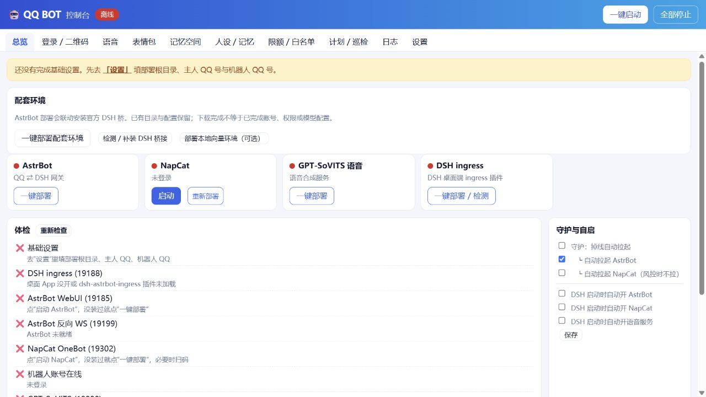
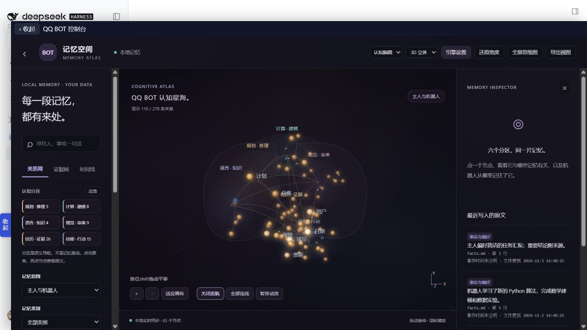
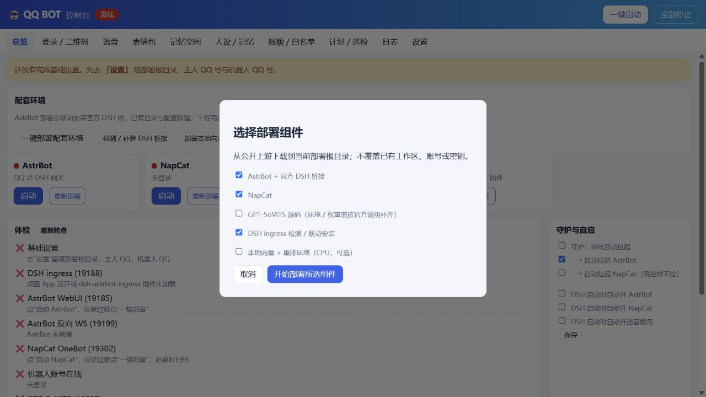

# QQ BOT for DSH Desktop · v1.1.0

一个面向 **DeepSeek Harness 桌面版**的 QQ BOT 插件。部署、登录、语音、表情包、人格文件、长期记忆、限额和日志都在同一个侧边栏内管理。包名沿用 `dsh-xiaoyu-qqbot`，界面统一显示 **QQ BOT**，不附带维护者的人格、聊天、账号、密钥或模型权重。

**适配声明：DSH >= 0.2.1-rc.2，Windows。** 本次实际安装验收使用桌面版自带的 **0.2.1-rc.5** 运行时；最低声明不代表每个历史版本均已逐版测试。Node >=18；组件自动部署还需要 Git 和 [uv](https://docs.astral.sh/uv/getting-started/installation/)。

> 许可证沿用 [Noncommercial License 1.0](LICENSE)：个人、学习、科研和非盈利用途免费；商业或公司内部使用请先联系作者。第三方组件与模型各自遵循其许可证。

## 1.1.0 新功能

- **认知星海**：六个语义分区、稳定三维布局、稀疏星海背景、暖色恒星 / 蓝色行星、区域聚焦与真实来源跨区束线；支持原星图、2D、宽屏、原生全屏、Esc、Shift 平移、暂停和持续动效。分区是产品导航，不是人脑功能定位。
- **本地混合检索**：BGE 中文向量 + SQLite FTS5 / BM25 + RRF + 按需加载的 CPU 交叉编码重排，512 维；不依赖线上 Hindsight，不占显存。原文带来源 / 行号，支持更新删除、重启持久化、范围隔离和上下文预算。
- **证据回顾**：按日期整理检索原文；`generated=false`，不是完整 Hindsight 生成式 Reflect，不自动覆盖矛盾事实，也没有自动接管 QQ 会话的记忆注入。
- **联动安装前置桥接**：部署 AstrBot 时自动检测 / 补装官方 `astrbot_plugin_dsh`。总览也提供独立补装按钮。使用固定 GitHub 提交，已有目录与配置不覆盖，下载失败不留下半成品插件。
- **一键部署配套环境**：选择 AstrBot + 桥接、NapCat、DSH ingress、可选语音源码和本地记忆环境。逐项报告成功、失败或待手动配置，不把“下载完成”当成“账号 / 模型已就绪”。
- **隔离与脱敏**：独立路由、DOM / 消息命名空间和默认数据目录；完整空白人格 / 记忆占位，初始化只补缺失文件。

原有登录二维码、风控提示、语音参考音频处理、表情包管理、主人 / 陌生人限额、计划任务、日志、备份功能保留。更新明细见 [CHANGELOG](CHANGELOG.md)。

## 截图

以下均由**独立虚构演示工作区**产生，未连接真实 QQ 或复用维护者的数据。





## 安装 / 更新到 1.1.0

在 **DSH 桌面端的「插件」→「添加插件」**中填写：

```text
github:ZOTTALL/dsh-xiaoyu-qqbot#v1.1.0
```

也可使用**桌面版安装 / 管理的 `dsh` 命令**（不是另装的 npm CLI）：

```powershell
dsh plugin --profile desktop add github:ZOTTALL/dsh-xiaoyu-qqbot#v1.1.0
```

若使用克隆目录：

```powershell
git clone --branch v1.1.0 https://github.com/ZOTTALL/dsh-xiaoyu-qqbot.git
dsh plugin --profile desktop add link:C:/path/to/dsh-xiaoyu-qqbot
```

在桌面端重载组件并刷新页面。首次打开「设置」，填写自己的部署根目录、主人 / 机器人 QQ；再在「总览」选择部署组件。**默认不自启服务、不开放陌生人的工具权限。**

已有 1.0.1 用户：先备份 `qqbot.config.json`、整个工作区和 AstrBot 配置。推荐把真实配置放在仓库外，以 `QQBOT_CONFIG` 指向它，再更新依赖。不要拿示例配置覆盖已有配置。回退可重新选择 `#v1.0.1`；先停用新版组件再重载，原始记忆与派生索引均不因回退而删除。

## 前置桥接：两个插件，分别安装

| 组件 | 安装位置 | 本项目怎样处理 |
|---|---|---|
| [`astrbot_plugin_dsh`](https://github.com/CCYellowStar2/astrbot_plugin_dsh) | **AstrBot** 的 `data/plugins/astrbot_plugin_dsh` | 部署 AstrBot 时联动补装；也可点「检测 / 补装 DSH 桥接」 |
| [`dsh-astrbot-ingress`](https://github.com/CCYellowStar2/dsh-astrbot-ingress) | **DSH 桌面端**的插件列表 | 检测在线状态；缺失时经宿主 pluginManager 安装；宿主要求重启时显示待完成 |

**不要把 AstrBot 插件填进 DSH 插件列表。** 两端都加载后才形成 `QQ → NapCat → AstrBot → DSH ingress → DSH`。同机桥接可按上游机制发现 ingress 信标；容器部署、端口映射、token 和权限仍需按上游说明配置。安装来源 / 固定提交见 [tools/upstreams.json](tools/upstreams.json)。

## 陌生人好友私聊 / QQ 群聊：额外配置 AstrBot

**想使用陌生人加好友对话、好友申请处理或 QQ 群群聊，需要额外配置 AstrBot**：OneBot 适配器、触发方式 / 唤醒词、群与用户白名单、模型提供方、群会话隔离、好友申请处理及本项目的可选限额扩展。不要仅安装桥接就向所有人开放 DSH 工具。

- **人格文件可以复用 DSH 中的内容**：把自己确认需要的 `AGENTS.md` 规则复制 / 整理为 AstrBot 人格；仅设置同一份文件不会让普通 AstrBot 聊天自动获得 DSH 的工具或权限。可通过设置工作区复用自己已有的人格文件；模板初始化不会覆盖它们。
- **模型密钥可以复用自己的可用 DSH API 密钥**：经 `/dsh` 桥接的请求直接使用 DSH 当前模型配置，无需复制密钥；由 AstrBot 独立回复的陌生人 / 群聊，则在 AstrBot 模型提供方中自行填写相应 API 地址与密钥。DSH 登录态 / 临时 OAuth 令牌与普通模型 API key 不能混用。插件不会读取、展示或自动复制你的 DSH 凭据。

详细说明：[部署](docs/DEPLOY.md) · [配置](docs/CONFIG.md) · [桥接联动](docs/BRIDGE.md) · [陌生人 / 群聊](docs/CHAT-MODES.md) · [记忆架构](docs/MEMORY.md)。

## 一键部署的完成范围

| 组件 | 自动完成 | 用户仍需完成 |
|---|---|---|
| AstrBot + 官方桥接 | 固定提交源码、独立 Python 3.12 环境、pyproject 依赖、桥接检测 / 安装 | WebUI 初始化、OneBot / 模型 / 权限配置；运行中安装后重载桥接 |
| NapCat | 校验 SHA256 的 Windows OneKey 启动器 | 首次由启动器准备 QQ / 协议环境并扫码；OneBot 地址与访问凭据 |
| DSH ingress | 已在线则跳过；可用宿主中联动安装固定提交 | 按宿主要求启用 / 重启；自定义端口 / 容器 token |
| GPT-SoVITS | 固定源码准备 | 官方环境 / 权重 / 授权参考音频；本项目明确标记为 `partial` |
| 本地向量环境 | 独立 Python 3.11、固定依赖与哈希校验模型、CPU 推理配置 | 安装 uv；首次下载约 320MB 模型文件，预留内存；无需模型 API key |

## 与现有组件不冲突的测试方法

最稳妥的方式是 **独立 `DSH_HOME` + 独立测试 profile + 独立 `QQBOT_CONFIG` / 数据目录 / 端口**。不要复制现有 DSH 凭据，不要把测试版装进正在使用的 `desktop` profile。本项目的公开入口 `/dsh-xiaoyu-qqbot` 和 `dshpubqq-*` DOM 与另一套控制台分离；如果主动把两套配置指向同一个服务目录，仍可能相互操作同一服务。

隔离命令与本次验证边界见 [隔离测试](docs/ISOLATED-TEST.md)。

## 人格与记忆占位

`persona-template/` 保留身份、底层规则、性格、语言、状态、能力、成长、事实、用户档案、背景知识、表情包约定、日记与陌生人记录等结构，内容均为 `{{待填写}}` 或基础规则。示例日期是虚构的，不是维护者的聊天记录。数据库、好友申请记录、音色文件、真实密钥和运行目录不分发。

```powershell
# 使用自己的 QQBOT_CONFIG；只补缺失模板，不覆盖已有内容
npm run init:workspace
```

## 开发与验证

```powershell
npm run check
npm test
npm run privacy
node tools/create-demo.mjs C:/path/to/empty-demo
# 将上条输出的配置路径设为 QQBOT_CONFIG，再启动本机只读预览
node tools/preview.mjs 8799
```

真实语义集成测试需要额外提供 `QQBOT_MEMORY_PYTHON`、`QQBOT_MEMORY_MODEL`、`QQBOT_MEMORY_RERANKER`，再运行 `npm run test:semantic`；未配置时明确跳过，不把文本检索冒充向量测试。完整原理、资源与边界见 [MEMORY.md](docs/MEMORY.md)。问题报告不要附真实配置 / 聊天 / 密钥，见 [SECURITY](SECURITY.md)。

## 致谢

[DeepSeek Harness](https://github.com/deepseek-ai/deepseek-harness) · [NapCat](https://github.com/NapNeko/NapCatQQ) · [AstrBot](https://github.com/AstrBotDevs/AstrBot) · [GPT-SoVITS](https://github.com/RVC-Boss/GPT-SoVITS) · [DSH 桥](https://github.com/CCYellowStar2/astrbot_plugin_dsh) · [DSH ingress](https://github.com/CCYellowStar2/dsh-astrbot-ingress) · [BGE](https://github.com/FlagOpen/FlagEmbedding)。
