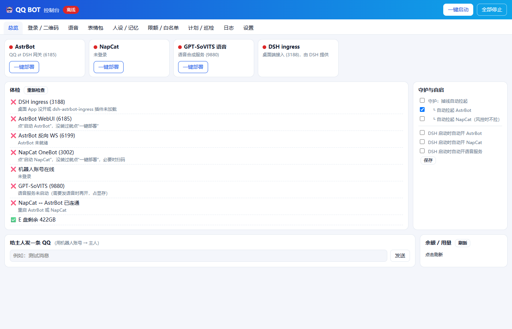
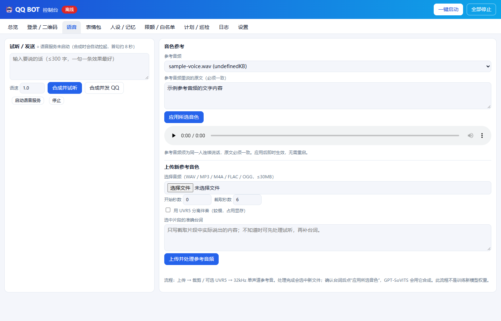
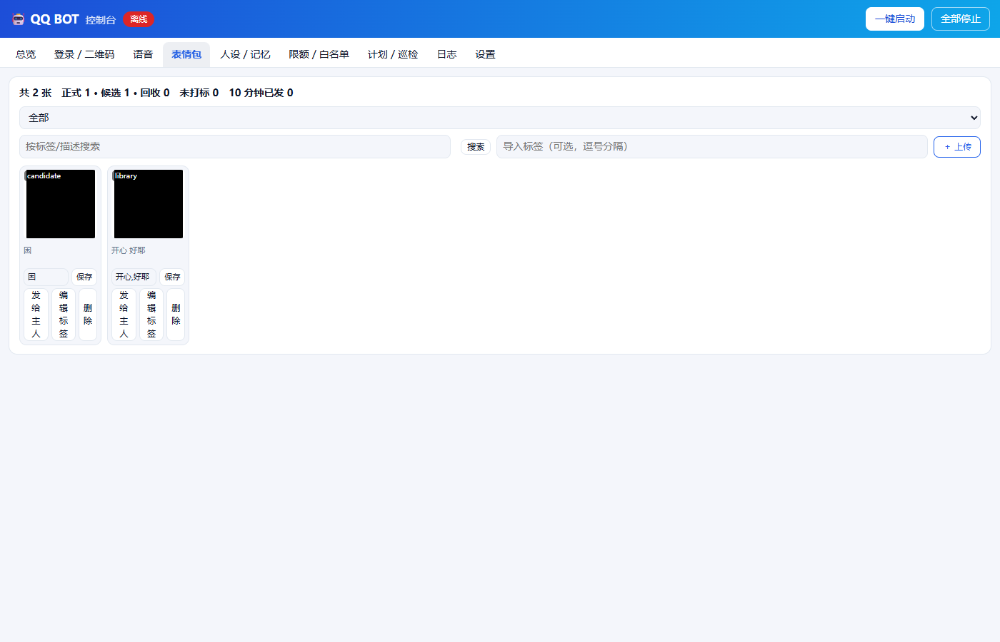
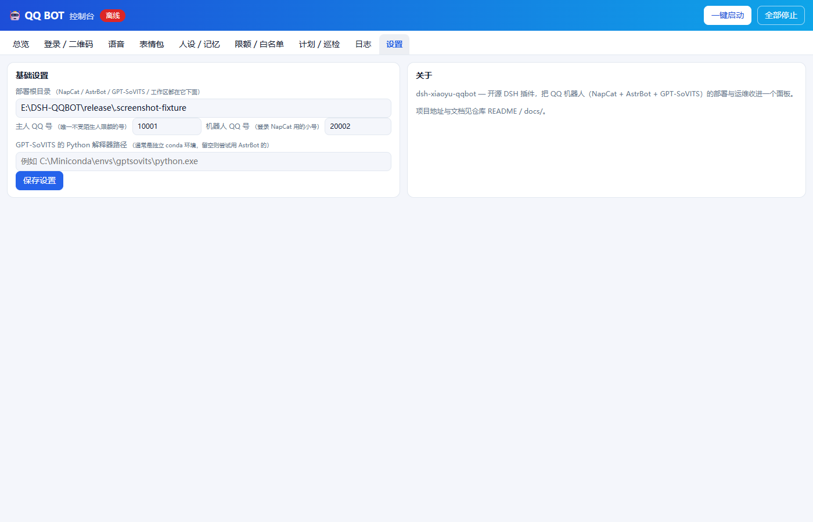

# dsh-xiaoyu-qqbot

一个 [DeepSeek Harness (DSH)](https://github.com/) 桌面端插件：把 QQ 机器人的部署、启停、登录、
语音、表情包、人设与记忆、陌生人限额、计划任务、日志全部收进 DSH 里的一个面板。

技术栈：[NapCat](https://github.com/NapNeko/NapCatQQ)（QQ 协议端）+
[AstrBot](https://github.com/Soulter/AstrBot)（QQ ⇄ LLM 网关）+
[GPT-SoVITS](https://github.com/RVC-Boss/GPT-SoVITS)（语音合成，可选）。

> 要求 DSH **>= 0.2.1-rc.2**；目前只支持 Windows（NapCat 一体包与进程管理依赖 Win32 API）。

## 特性

- **一键部署**：总览页每个组件（NapCat / AstrBot / GPT-SoVITS）都有「一键部署」按钮，自动下载/
  克隆/建环境；DSH ingress 由桌面端自带，只做可用性检查。
- **一键启停**：启动顺序自动处理（先 AstrBot 再 NapCat）；全部停止只杀部署目录下的进程，不影响
  系统里其他 QQ。
- **实时登录二维码**：直接读 NapCat 的二维码文件，过期自动换新图；识别腾讯风控（`168`）并给出
  人话解释和下一步。
- **语音**：合成试听/直接发 QQ；支持上传新参考音频，自动裁剪 + 可选 UVR5 人声分离 + 转换成
  32kHz 单声道参考音（不训练新模型权重）。
- **表情包**：网格浏览、搜索、按层筛选，发送/改标签/删除恢复，支持批量上传打标。
- **人设 / 记忆编辑器**：在面板里直接改 `AGENTS.md` 和记忆文件，保存自动备份；本地 SQLite FTS5
  检索，零依赖、零网络。
- **陌生人限额 / 白名单**：条数、提醒文案、重新计数间隔都在面板里改；配套一个独立的 AstrBot 扩展
  插件（见 [`astrbot-bridge-addon/`](astrbot-bridge-addon)）落地这些规则。
- **计划任务**：Windows 任务计划程序集成，面板里能看状态、立即运行、启停。
- **日志**：四个来源（NapCat / AstrBot / 语音 / 控制台）实时 SSE 推送，UTF-8 解码，不再乱码。

## 截图

| 总览 | 语音 |
|---|---|
|  |  |

| 表情包 | 设置 |
|---|---|
|  |  |

> 以上截图用的是本地测试夹具（假 QQ 号、假端口、未连接任何真实服务），不包含任何真实账号信息。

## 安装

```bash
git clone https://github.com/ZOTTALL/dsh-xiaoyu-qqbot.git
dsh plugin --profile <你的profile> add link:/path/to/dsh-xiaoyu-qqbot
```

打开 DSH 桌面端，刷新页面，右侧会出现一条蓝色把手——点开就是控制台。第一次打开先去「设置」页
填部署根目录、主人 QQ 号、机器人 QQ 号，然后回「总览」给还没装的组件点「一键部署」。

详细步骤、目录约定、手动安装路径见 [`docs/DEPLOY.md`](docs/DEPLOY.md)。

## 人设

`persona-template/` 下是人设文件的占位模板（`AGENTS.md`、`memory/*.md`、`voice.json.example`），
**不包含任何真实人格设定**——把它们复制到你的工作区目录（见 `docs/CONFIG.md` 的 `workspace`
路径），照着占位提示写成你自己想要的机器人人格。改完在 QQ 里发 `/dsh new` 让它生效。

## 配套的 AstrBot 插件

本仓库假定你已经按官方文档装好了
[`astrbot_plugin_dsh`](https://github.com/CCYellowStar2/astrbot_plugin_dsh)（把消息桥接到
DSH 的核心插件，第三方独立维护，本仓库不分发它的代码）。

本仓库额外自带一个小插件 [`astrbot-bridge-addon/`](astrbot-bridge-addon)（陌生人限额、自动
表情包、动作描写清理），装进 AstrBot 的 `data/plugins/dsh_xiaoyu_addon/` 即可，详见
[`docs/ADDON.md`](docs/ADDON.md)。

## 安全

面板能启停进程、改文件、跑部署脚本，访问控制和边界说明见 [`docs/SECURITY.md`](docs/SECURITY.md)。
简要版：只认回环 Host、CSRF 保护、文件白名单、进程操作限定在部署根目录内。

## 开发

```bash
cd dsh-xiaoyu-qqbot
npm run check     # node --check 全部 lib/ 和 assets/ 文件
npm test          # node --test test/*.test.mjs
node tools/preview.mjs 8799    # 本地预览（无鉴权，仅调试用，别对外暴露）
```

### 项目结构

```
lib/              宿主插件逻辑（路由、信任栅栏、进程管理、语音、表情包、部署脚本）
assets/           面板前端（纯 HTML/CSS/JS，无构建步骤）
tools/            Python/PowerShell 工具脚本（语音、表情包、记忆库、巡检）
persona-template/ 人设占位模板
astrbot-bridge-addon/  配套 AstrBot 扩展插件（独立安装）
docs/             部署、配置、安全、扩展插件说明
test/             node:test 单元与路由测试
```

## 许可证

MIT，见 [LICENSE](LICENSE)。

## 致谢

- [NapCat](https://github.com/NapNeko/NapCatQQ)
- [AstrBot](https://github.com/Soulter/AstrBot)
- [GPT-SoVITS](https://github.com/RVC-Boss/GPT-SoVITS)
- [astrbot_plugin_dsh](https://github.com/CCYellowStar2/astrbot_plugin_dsh) by CCYellowStar2
